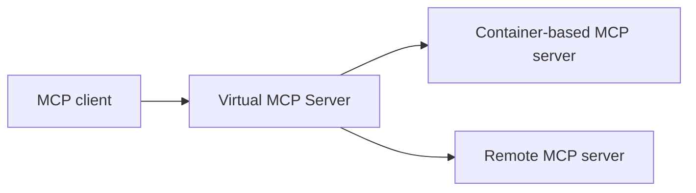

Virtual MCP Server (vMCP) combines tools from multiple MCP servers behind one
endpoint. Your client connects to vMCP, which routes each request to the backend
that provides the tool. You can run vMCP locally with the ToolHive CLI or deploy
it on Kubernetes with the ToolHive operator.

## The problem vMCP solves

Separate MCP servers each have their own connection settings and tool lists. As
you add servers, every client needs access to the right endpoints. Tools with
overlapping names also become harder to distinguish.

vMCP gives clients one connection and lets you control the combined tool list.
For example, you can expose tools from an internal documentation server and a
remote issue tracker through the same endpoint, while configuring credentials
for each backend separately.

## When to use vMCP

Use vMCP when you want one client connection for several servers, need to curate
the tools a team can access, or want to compose calls across backends. These
needs can arise with just two servers. The number of servers alone doesn't
determine whether aggregation is useful.

Running servers separately remains a good choice when your client already
manages their connections and tool lists well. vMCP adds a process to operate
and a shared dependency for the backends it exposes.

## Architecture overview

### How it works

In a local deployment, vMCP reads a [ToolHive group](./groups.mdx) on your
machine. The `thv vmcp serve` command runs in the foreground and connects to the
group's running servers. You manage its process lifetime and local
configuration.

On Kubernetes, a `VirtualMCPServer` resource references an `MCPGroup` in the
same namespace. Backend resources join that group through `spec.groupRef`. The
operator discovers the backends and manages the vMCP deployment and service. The
group can contain three resource types:

| Resource                                             | Backend connection                                                  |
| ---------------------------------------------------- | ------------------------------------------------------------------- |
| [MCPServer](../reference/crds/mcpserver.mdx)         | A container-based MCP server running in the cluster                 |
| [MCPRemoteProxy](../guides-k8s/remote-mcp-proxy.mdx) | A remote MCP server reached through a proxy managed by the operator |
| [MCPServerEntry](../guides-k8s/mcp-server-entry.mdx) | A remote MCP server registered for routing without a proxy pod      |

The local CLI suits development and evaluation. Kubernetes provides declarative
deployment and lifecycle management for shared services. Each path has its own
configuration format: local runtime YAML for the CLI, and Kubernetes resources
for the operator. Feature setup and identity configuration depend on that
deployment choice.

## Key capabilities

### Multi-server aggregation

vMCP presents a combined tool list and routes calls to the appropriate backend.
You choose how to resolve tool-name conflicts. With the `prefix` strategy and
the format `{workload}_`, tools named `search` from two backends become, for
example, `docs_search` and `issues_search`.

You can filter tools and override their names or descriptions to tailor the
combined list. These settings belong to the aggregation configuration; access
policies belong to authorization. See
[Tool aggregation and conflict resolution](../guides-vmcp/tool-aggregation.mdx).

### Authentication boundary separation

Clients authenticate to vMCP, and vMCP authenticates to its backends. These are
separate boundaries: a client credential that vMCP accepts doesn't necessarily
grant access to a backend.

Configure each boundary for your deployment. Backends can use different
credentials or token-exchange strategies, while authorization policies control
which requests are allowed. The embedded authorization server provides an OAuth
flow for deployments that need to broker upstream sign-in. See
[vMCP authentication](../guides-vmcp/authentication.mdx) for the configuration
paths and [Backend authentication](./backend-auth.mdx) for pattern selection.

### Multi-step workflows (composition)

[Composite tools](../guides-vmcp/composite-tools.mdx) define reusable workflows
that call backend tools and pass results between steps. Use them when you want
to publish a fixed workflow as one tool. A workflow can supply fixed arguments
to its backend calls and expose only the inputs its callers need.

[Code mode](../guides-vmcp/code-mode.mdx) lets an agent submit a Starlark script
that calls backend tools server-side. Use it when the agent needs to decide the
sequence of calls for the task at hand. Both approaches reduce the need for
clients to coordinate each backend call themselves.

## Optimize tool discovery

As the combined tool list grows, its definitions consume more of a model's
context. The optimizer exposes `find_tool` and `call_tool` so the client can
search for a relevant tool and invoke it, instead of receiving every tool
definition up front. Keyword search and embedding-based search have different
runtime requirements. See
[Optimize tool discovery](../guides-vmcp/optimizer.mdx) to choose and configure
an approach for your deployment.

## Next steps

- [Run vMCP locally](../guides-vmcp/local-cli.mdx) to combine servers on your
  workstation.
- [Try the Kubernetes quickstart](../guides-vmcp/quickstart.mdx) to deploy an
  aggregated endpoint and connect a client.
- [Configure an existing Kubernetes deployment](../guides-vmcp/configuration.mdx)
  to add backends and adapt its settings.

## Related information

- [vMCP guides](../guides-vmcp/index.mdx)
- [VirtualMCPServer reference](../reference/crds/virtualmcpserver.mdx)
- [`thv vmcp` command reference](../reference/cli/thv_vmcp.md)
